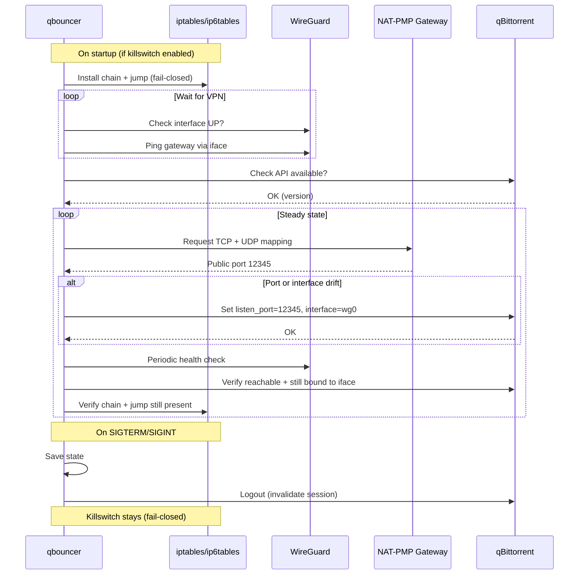

# qbouncer

A systemd service that monitors WireGuard VPN connectivity, manages NAT-PMP port mappings, and automatically keeps qBittorrent's listening port synchronized.

Designed for use with ProtonVPN's port forwarding feature, but should work with any VPN provider that supports NAT-PMP.

## Features

- Monitors WireGuard interface health (interface state, IP assignment, gateway reachability)
- Requests NAT-PMP port mappings via `natpmpc`
- Automatically updates qBittorrent's listening port when the mapped port changes
- Ensures qBittorrent is bound to the VPN interface
- Optional iptables/ip6tables killswitch (both IPv4 and IPv6) to prevent leaks
- State machine with automatic recovery from failures
- systemd integration with watchdog support
- State persistence across restarts

## Requirements

- Python 3.10+
- `natpmpc` (from libnatpmp)
- `wireguard-tools` (for `wg` command)
- A running WireGuard VPN with NAT-PMP support
- qBittorrent with Web UI enabled

## Installation

### Automatic (recommended)

The installer will guide you through the setup interactively:

```bash
curl -fsSL https://raw.githubusercontent.com/vegardx/qbouncer/main/scripts/install.sh | bash
```

> **Supply chain note:** `curl | bash` trusts whatever `raw.githubusercontent.com`
> serves at request time. For stronger guarantees, download first and verify the
> published checksum before executing:
>
> ```bash
> curl -fsSLo install.sh https://raw.githubusercontent.com/vegardx/qbouncer/main/scripts/install.sh
> # Check against the checksum published on the release page before running:
> sha256sum install.sh
> sudo bash install.sh
> ```

Or with options for non-interactive install. Pass credentials via environment
variables, not CLI flags, so they don't show up in `ps`:

```bash
QBT_PASSWORD="..." curl -fsSL https://raw.githubusercontent.com/vegardx/qbouncer/main/scripts/install.sh | \
  sudo -E bash -s -- \
    --non-interactive \
    --force-config \
    --wg-interface wg0 \
    --gateway 10.2.0.1 \
    --qbt-host localhost \
    --qbt-port 8080 \
    --qbt-username admin \
    --killswitch \
    --killswitch-user qbittorrent
```

The installer is idempotent and can be run multiple times safely to upgrade or reconfigure.

### Manual

```bash
# Install system dependencies (Debian/Ubuntu)
apt install python3 python3-venv libnatpmp1 wireguard-tools iptables git

# Clone the repository
git clone https://github.com/vegardx/qbouncer.git
cd qbouncer

# Create service user and matching group
useradd -r -U -s /usr/sbin/nologin qbouncer

# Create installation directory and virtual environment
mkdir -p /opt/qbouncer
python3 -m venv /opt/qbouncer/venv

# Install qbouncer into the virtual environment
/opt/qbouncer/venv/bin/pip install .

# Setup configuration (readable by the service user's group)
mkdir -p /etc/qbouncer
cp config/qbouncer.toml.example /etc/qbouncer/qbouncer.toml
chown root:qbouncer /etc/qbouncer /etc/qbouncer/qbouncer.toml
chmod 750 /etc/qbouncer
chmod 640 /etc/qbouncer/qbouncer.toml
$EDITOR /etc/qbouncer/qbouncer.toml

# Install and enable systemd service
cp systemd/qbouncer.service /etc/systemd/system/
systemctl daemon-reload
systemctl enable qbouncer
systemctl start qbouncer
```

### Uninstallation

```bash
sudo bash scripts/install.sh --uninstall
```

Add `--purge` to remove the configuration directory, state directory, and
service user without prompting.

Uninstalling also removes the killswitch rules, which otherwise outlive the
service (see [Killswitch](#killswitch)).

## Configuration

Configuration file: `/etc/qbouncer/qbouncer.toml`

See [`config/qbouncer.toml.example`](config/qbouncer.toml.example) for the
full list of options with inline documentation. Minimal working config:

```toml
[wireguard]
interface = "wg0"
health_check_host = "10.2.0.1"

[natpmp]
gateway = "10.2.0.1"

[qbittorrent]
host = "localhost"
port = 8080
username = "admin"
# password = ""              # See "Credentials" below for the safer options
interface_binding = "wg0"

[killswitch]
enabled = false               # Set true + user = "..." to enable the killswitch
```

Notable options documented in the example but worth calling out:
`qbt_use_https` + `qbt_ca_bundle` for a CA-pinned HTTPS connection to
qBittorrent, `availability_poll_interval` / `failure_retry_delay` to tune
cadence, and `[killswitch]` to enable the iptables/ip6tables killswitch.

### Killswitch

With `[killswitch] enabled = true`, qbouncer installs an iptables/ip6tables
chain (`QBOUNCER-KS`) at startup, before the VPN is confirmed up. Traffic
from the configured user may only leave through the VPN interface (and
loopback); everything else is rejected.

- **It fails closed.** The rules stay when qbouncer stops, restarts or is
  upgraded, so qBittorrent keeps working through the VPN but can't reach
  anything outside it. Remove them with `qbouncer --remove-killswitch`
  (run as root, with the same config) or `install.sh --uninstall`.
- **Rules don't survive a reboot.** Order qBittorrent after qbouncer so it
  never starts before the rules exist. For example, as a drop-in for the
  qBittorrent unit (`systemctl edit qbittorrent-nox@<user>`):

  ```ini
  [Unit]
  After=qbouncer.service
  Requires=qbouncer.service
  ```

  `Requires=` also stops qBittorrent when qbouncer is stopped by hand.
- **The tunnel's own packets are exempt.** WireGuard's encrypted UDP
  packets can carry the uid of the process whose traffic they wrap, so the
  chain allows packets with the interface's fwmark (`wg show <iface>
  fwmark`, set by wg-quick), or UDP to the peer endpoints when there's no
  fwmark. Needs `wg` from wireguard-tools.
- **DNS isn't covered.** Lookups go through the system resolver, which
  runs as a different user. Point the resolver at the VPN's DNS server if
  that matters.

### Environment Variables

Every `Config` field has a `QBOUNCER_<FIELD_NAME_UPPER>` env var that
overrides the TOML value. Examples:

```bash
QBOUNCER_WG_INTERFACE=wg0
QBOUNCER_NATPMP_GATEWAY=10.2.0.1
QBOUNCER_QBT_PORT=8080
QBOUNCER_LOG_LEVEL=DEBUG
```

### Credentials

Three ways to supply the qBittorrent password, in increasing preference:

1. **In the TOML file** — convenient, but the secret sits on disk in a
   config directory readable by the service group.
2. **`QBOUNCER_QBT_PASSWORD` env var** — useful for non-interactive
   installs. Be careful not to leak it into shell history.
3. **`QBOUNCER_QBT_PASSWORD_FILE` env var** (recommended) — points at a
   file whose first line is the password. The systemd unit ships with a
   commented-out `LoadCredential=qbt_password:/etc/qbouncer/credentials/qbt_password`
   line + matching `Environment=QBOUNCER_QBT_PASSWORD_FILE=%d/qbt_password`.
   Uncomment both, write the password to that file (mode `0600`), and
   the daemon reads it through systemd's per-service credentials tmpfs.
   This path beats both of the above when set.

## Usage

### As a systemd service

```bash
# Start the service
systemctl start qbouncer

# Check status
systemctl status qbouncer

# View logs
journalctl -u qbouncer -f

# Stop the service
systemctl stop qbouncer
```

### Manual execution

```bash
# Run with default config
/opt/qbouncer/venv/bin/qbouncer

# Run with custom config file
/opt/qbouncer/venv/bin/qbouncer --config /path/to/config.toml

# Override the log level (DEBUG, INFO, WARNING, ERROR)
/opt/qbouncer/venv/bin/qbouncer --log-level DEBUG

# Shortcut for --log-level DEBUG
/opt/qbouncer/venv/bin/qbouncer -v

# Print version and exit
/opt/qbouncer/venv/bin/qbouncer --version
```

## How It Works

1. **VPN Monitoring**: Checks that the WireGuard interface is UP, has an IP address, and can reach the gateway
2. **Port Mapping**: Requests TCP and UDP port mappings from the NAT-PMP gateway every 60 seconds
3. **qBittorrent Sync**: If the mapped port changes, updates qBittorrent's listening port via its Web API
4. **Interface Binding**: Verifies qBittorrent is bound to the VPN interface to prevent IP leaks

### Sequence Diagram



## Troubleshooting

### Check if WireGuard is working

```bash
# Verify interface is up
ip link show wg0

# Check connectivity
ping -I wg0 10.2.0.1

# Verify handshake
wg show wg0
```

### Check if NAT-PMP is working

```bash
# Request a port mapping manually
natpmpc -a 1 0 tcp 60 -g 10.2.0.1
```

### Check if qBittorrent API is accessible

```bash
# Log in (replace with your credentials) and keep the session cookie
curl -c /tmp/qbt.cookies -d 'username=admin&password=yourpass' \
    http://localhost:8080/api/v2/auth/login

# Now query with the cookie
curl -b /tmp/qbt.cookies http://localhost:8080/api/v2/app/preferences \
    | jq .listen_port
```

If the Web UI has authentication disabled (it does by default on localhost),
drop the first call and just hit `/api/v2/app/preferences` directly.

### View service logs

```bash
# Full logs
journalctl -u qbouncer

# Follow logs
journalctl -u qbouncer -f

# Logs since last boot
journalctl -u qbouncer -b
```

## License

MIT License - see [LICENSE](LICENSE) for details.
